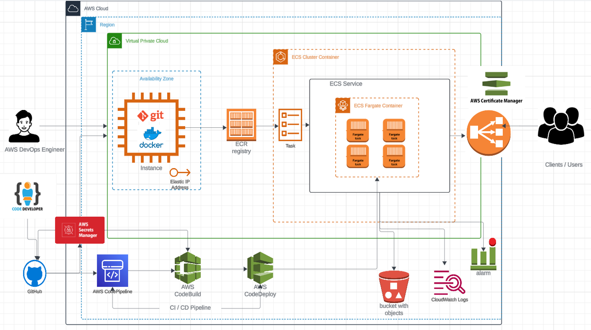

# 🚀 AWS ECS Fargate – End-to-End CI/CD Pipeline for Web Application

<p align="center">
  
  
  
  
  
</p>

<p align="center">
  <b>Automating containerized web application deployment using AWS DevOps services.</b>
</p>

---

## 📌 Project Overview

This project demonstrates an end-to-end Continuous Integration and Continuous Deployment (CI/CD) pipeline for deploying a containerized web application on **Amazon ECS using AWS Fargate**.

The pipeline integrates GitHub with AWS developer tools to automate the application build and deployment process.

Whenever a developer pushes code changes to the configured GitHub branch, AWS CodePipeline triggers the workflow, CodeBuild builds the Docker image, Amazon ECR stores the container image, and Amazon ECS deploys the application using Fargate.

The objective is to reduce manual deployment efforts and implement an automated cloud-native deployment workflow.

## 🏗️ Architecture Diagram

<p align="center">
  
</p>

## 🔄 CI/CD Workflow

1. **Developer:** Updates the application source code.
2. **GitHub:** Stores the source code and triggers the pipeline when changes are pushed.
3. **AWS CodePipeline:** Orchestrates the CI/CD workflow.
4. **Amazon S3:** Stores the source artifact generated by the pipeline.
5. **AWS CodeBuild:** Reads the source artifact, builds the Docker image, and prepares it for deployment.
6. **Amazon ECR:** Stores the built Docker image.
7. **Amazon ECS:** Uses the container image to run the application.
8. **AWS Fargate:** Provides serverless container compute without managing EC2 instances.
9. **End User:** Accesses the deployed web application through its configured endpoint.

## 🛠️ Technology Stack

| Technology | Purpose |
|---|---|
| AWS CodePipeline | CI/CD orchestration |
| AWS CodeBuild | Docker image build |
| Amazon S3 | Pipeline artifact storage |
| Amazon ECR | Docker image repository |
| Amazon ECS | Container orchestration |
| AWS Fargate | Serverless container execution |
| IAM | Access management and permissions |
| Amazon CloudWatch | Build and deployment logs |
| GitHub | Source code management |
| Docker | Application containerization |
| YAML | Build configuration |

## 📂 Project Structure

```text
AWS-ECS-Fargate-End-to-End-CI-CD-Pipeline-for-Web-Application/
│
├── architecture/
│   └── aws-ecs-fargate-cicd-architecture.png
│
├── images/
│
├── css/
│
├── fonts/
│
├── js/
│
├── Dockerfile
├── buildspec.yml
├── index.html
└── README.md
```

## ⚙️ Implementation Steps

### Step 1: Create the GitHub Repository

- Create a GitHub repository.
- Upload the web application source code.
- Add the Dockerfile and buildspec.yml.
- Configure the required branch for pipeline integration.

### Step 2: Create an Amazon ECR Repository

Create an ECR repository to store the Docker images generated during the build process.

Example repository name:

```text
website
```

### Step 3: Configure AWS CodeBuild

Create a CodeBuild project and
